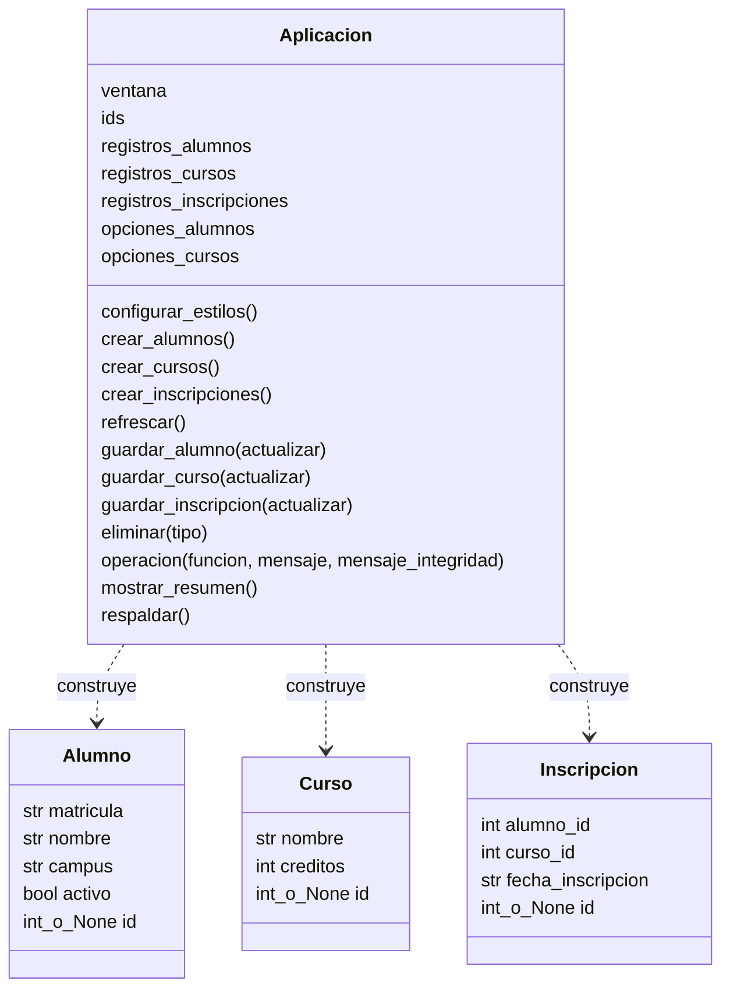
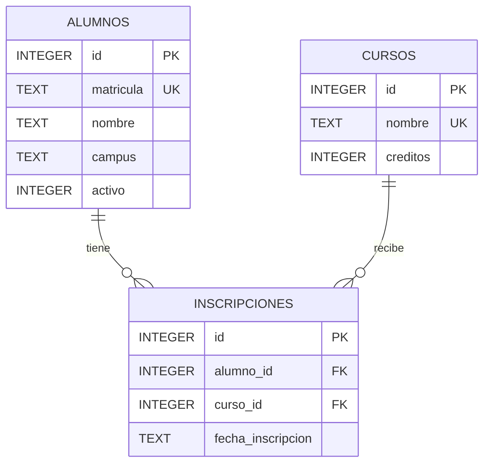

# Manual técnico de Control Escolar

**Producto 2.2: El manual técnico del software de aplicación desarrollado**  
**Taller de Alineación al estándar EC0835**  
**Estándar:** Desarrollar software de aplicación con acceso a bases de datos  
**Autor:** José Daniel Apodaca Ramírez  
**Institución:** CESUN Universidad  
**Lugar y fecha:** Tijuana, Baja California; 11 de octubre de 2026  
**Versión documental:** 1.0

## Índice

1. [Introducción](#1-introducción)
2. [Objetivo general del sistema](#2-objetivo-general-del-sistema)
3. [Objetivos específicos del sistema](#3-objetivos-específicos-del-sistema)
4. [Requerimientos e instalación](#4-requerimientos-e-instalación)
5. [Diagrama de clases](#5-diagrama-de-clases)
6. [Diagrama entidad-relación](#6-diagrama-entidad-relación)
7. [Desarrollo técnico](#7-desarrollo-técnico)
8. [Descripción de la interfaz](#8-descripción-de-la-interfaz)
9. [Verificación y mantenimiento](#9-verificación-y-mantenimiento)
10. [Código de la aplicación](#10-código-de-la-aplicación)
11. [Revisión de los requisitos proporcionados](#11-revisión-de-los-requisitos-proporcionados)

## 1. Introducción

Control Escolar es una aplicación de escritorio destinada al personal administrativo de una institución educativa. Permite registrar y administrar alumnos, cursos y las inscripciones que los relacionan. Su interfaz se desarrolla con Tkinter y sus datos se almacenan localmente en SQLite.

El sistema se elaboró como Producto 2.1 del Taller de Alineación al estándar EC0835. Este manual constituye el Producto 2.2 y describe su estructura interna, modelo de datos, dependencias, configuración, funcionamiento y código fuente. Está dirigido a quienes deban comprender, mantener o reproducir el proyecto.

La aplicación opera en un equipo local sin servidor de base de datos ni conexión a Internet para su uso cotidiano. El alcance comprende operaciones CRUD (crear, consultar, actualizar y eliminar), búsqueda de alumnos, filtro de inscripciones por alumno, resumen de inscritos por curso y respaldo de la base. No incluye calificaciones, pagos, asistencia, autenticación ni sincronización entre equipos.

## 2. Objetivo general del sistema

Facilitar la administración local de alumnos, cursos e inscripciones mediante una aplicación gráfica que permita mantener información organizada, consultar relaciones entre registros y conservar los datos en una base SQLite.

## 3. Objetivos específicos del sistema

- Registrar, consultar, actualizar y eliminar alumnos y cursos.
- Relacionar alumnos con cursos mediante inscripciones con fecha.
- Evitar matrículas, nombres de cursos y pares alumno-curso duplicados.
- Validar campos obligatorios, créditos y fechas desde la interfaz.
- Buscar alumnos por matrícula, nombre o campus.
- Consultar todas las inscripciones o únicamente las de un alumno.
- Obtener el número de inscritos por curso, incluyendo cursos sin inscripciones.
- Proteger las relaciones al impedir la eliminación de alumnos o cursos referenciados.
- Crear copias de seguridad mediante la API de respaldo de SQLite.
- Distribuir el programa como ejecutable Windows generado con PyInstaller.

## 4. Requerimientos e instalación

### 4.1. Hardware y sistema operativo

Los valores siguientes son recomendaciones para este proyecto; no representan mínimos medidos ni una certificación de rendimiento.

| Componente | Recomendación |
|---|---|
| Procesador | Arquitectura x86-64 compatible con Windows de 64 bits |
| Memoria | 4 GB de RAM o más para el equipo completo |
| Pantalla | 1366 × 768 o superior; ajustar la escala si se ocultan controles |
| Almacenamiento | Reservar 200 MB para ejecutable, extracción temporal y datos; ampliar según registros y respaldos |
| Entrada | Teclado y ratón o dispositivo equivalente |
| Permisos | Escritura en la carpeta del programa y acceso a la carpeta temporal del usuario |
| Sistema objetivo | Windows de 64 bits; compatibilidad adicional pendiente de verificación por versión |

La ventana se configura inicialmente en 1000 × 700 y admite un mínimo de 900 × 640. La escala de pantalla puede modificar el espacio disponible. El autor reportó ejecución satisfactoria en su equipo y en otra laptop; no se proporcionaron sus especificaciones ni versiones exactas de Windows.

### 4.2. Entorno de desarrollo y dependencias

| Componente | Función | Versión o procedencia |
|---|---|---|
| Python | Lenguaje y entorno de ejecución | 3.15.0, según salida de terminal proporcionada |
| Tkinter y ttk | Ventanas, controles, tablas y estilos | Distribución de Python utilizada; Tcl/Tk no medido |
| SQLite / sqlite3 | Persistencia y consultas SQL | Módulo estándar; versión del motor no registrada |
| dataclasses | Modelos de datos | Biblioteca estándar |
| datetime, pathlib y sys | Fechas, rutas y detección del ejecutable | Biblioteca estándar |
| PyInstaller | Empaquetado | 6.22.3, según instalación reportada |
| Visual Studio Code | Edición del proyecto | Versión no registrada |
| PowerShell | Comandos de preparación | Versión no registrada |
| Git | Control de versiones | No necesario para ejecutar la aplicación |

Tkinter y SQLite no se instalan con pip en este procedimiento. PyInstaller es una dependencia de empaquetado, no una biblioteca que el usuario final deba instalar. Sus dependencias auxiliares se resuelven durante la instalación con pip.

### 4.3. Preparación del código fuente

Los cuatro módulos deben estar en la misma carpeta: `main.py`, `models.py`, `crud.py` y `db.py`. Desde PowerShell, ubicado en esa carpeta:

```powershell
python -m venv .venv
.\.venv\Scripts\Activate.ps1
python -m tkinter
python main.py
```

El comando de Tkinter abre una ventana de prueba. Al iniciar el sistema se crea `escuela.db` si no existe y se preparan las tablas con `CREATE TABLE IF NOT EXISTS`.

### 4.4. Generación del ejecutable

Con el entorno virtual activo y la aplicación cerrada:

```powershell
python -m pip install pyinstaller==6.22.3
python -m PyInstaller --clean --onefile --windowed --name Producto_2.1_Ejecutable_JoseApodaca main.py
```

`--onefile` genera un ejecutable único, `--windowed` evita abrir una consola y `--name` establece el nombre de salida. El nombre debe adecuarse al formato académico solicitado: `Producto_2.1_Ejecutable_NombreApellido.exe`.

El resultado se encuentra en `dist`. El empaquetado debe realizarse en Windows para producir el ejecutable Windows de este proyecto. Los cuatro módulos y las bibliotecas estándar se incorporan al paquete; la base de datos permanece como archivo externo modificable.

### 4.5. Instalación para el usuario final

1. Copiar el ejecutable en una carpeta local con permiso de escritura.
2. Copiar `escuela.db` a su lado únicamente si se desea distribuir una base existente.
3. Abrir el ejecutable. Si no hay una base, se crea una vacía automáticamente.
4. Mantener el archivo de datos junto al ejecutable y respaldarlo periódicamente.

El usuario final no necesita instalar Python. La ejecución desde código y desde el ejecutable puede usar bases distintas: el código guarda la base junto a `db.py`; el ejecutable la guarda junto al `.exe`. Copiar solamente el programa a otra carpeta no traslada los registros existentes.

## 5. Diagrama de clases

El sistema define cuatro clases propias. `Alumno`, `Curso` e `Inscripcion` son dataclasses: transportan datos y reciben automáticamente métodos como el constructor. `Aplicacion` administra la interfaz y construye estos objetos antes de enviarlos a las funciones CRUD.



El diagrama muestra los atributos y métodos principales de `Aplicacion`; los auxiliares de construcción, selección y mensajes están disponibles en el código del anexo. No hay herencia entre las clases propias. `Inscripcion` guarda identificadores enteros, no referencias a objetos `Alumno` o `Curso`; sus relaciones persistentes se describen en el diagrama entidad-relación. `db.py` y `crud.py` son módulos con funciones, no clases.

## 6. Diagrama entidad-relación



Cada inscripción pertenece a exactamente un alumno y un curso. Un alumno y un curso pueden tener cero o muchas inscripciones. La relación conceptual muchos-a-muchos entre alumnos y cursos se resuelve mediante `inscripciones`. La pareja `(alumno_id, curso_id)` es única.

### 6.1. Diccionario de datos

| Tabla | Campo | Tipo SQLite | Restricción y significado |
|---|---|---|---|
| alumnos | id | INTEGER | Clave primaria autoincremental |
| alumnos | matricula | TEXT | Obligatorio, único, comparación NOCASE |
| alumnos | nombre | TEXT | Obligatorio; nombre completo |
| alumnos | campus | TEXT | Obligatorio; campus del alumno |
| alumnos | activo | INTEGER | Obligatorio, predeterminado 1, permitido 0 o 1 |
| cursos | id | INTEGER | Clave primaria autoincremental |
| cursos | nombre | TEXT | Obligatorio, único, comparación NOCASE |
| cursos | creditos | INTEGER | Obligatorio y mayor que cero |
| inscripciones | id | INTEGER | Clave primaria autoincremental |
| inscripciones | alumno_id | INTEGER | Obligatorio, clave foránea a alumnos.id |
| inscripciones | curso_id | INTEGER | Obligatorio, clave foránea a cursos.id |
| inscripciones | fecha_inscripcion | TEXT | Obligatorio; la interfaz exige AAAA-MM-DD |

`ON DELETE RESTRICT` impide eliminar un padre con inscripciones. `PRAGMA foreign_keys = ON` activa esta comprobación en cada conexión. NOCASE de SQLite no proporciona una normalización lingüística completa para todos los caracteres Unicode.

Las longitudes máximas, el límite de 100 créditos y la validación de fecha se aplican en la interfaz; no todos ellos están replicados como restricciones de la base. `NOT NULL` tampoco impide por sí solo cadenas vacías.

## 7. Desarrollo técnico

### 7.1. Organización y responsabilidades

| Archivo | Responsabilidad |
|---|---|
| main.py | Construcción de la interfaz, estado seleccionado, validación, coordinación de operaciones y respaldo |
| models.py | Estructuras de datos Alumno, Curso e Inscripcion |
| crud.py | Consultas SQL y operaciones de persistencia |
| db.py | Resolución de la ruta, conexión y creación del esquema |

Se utiliza una separación modular sencilla. La interfaz no está desacoplada completamente de SQLite: `main.py` captura sus excepciones y realiza directamente el respaldo. No se implementa un servidor, ORM ni una arquitectura web.

### 7.2. Inicio y eventos

`main()` crea la ventana y la oculta durante la preparación, llama a `crear_tablas()` y construye `Aplicacion`. Después muestra la ventana e inicia `mainloop()`, el ciclo de eventos de Tkinter. Los botones ejecutan funciones mediante `command`; la selección de filas y de filtros utiliza enlaces de eventos con `bind`.

Los identificadores seleccionados se guardan en `ids`. Los diccionarios `registros_*` permiten recuperar una fila por su identificador. Los diccionarios `opciones_*` traducen etiquetas legibles de los selectores a los identificadores reales de la base.

### 7.3. Flujo CRUD

Para agregar, la interfaz lee y valida los campos, construye una dataclass y llama a la función de `crud.py`. Para actualizar, exige una fila seleccionada y envía su identificador. Para eliminar, exige selección y confirmación. Las consultas recuperan filas SQLite accesibles por nombre de columna.

`ejecutar()` abre una conexión por operación. En consultas retorna `fetchall()`; en escrituras confirma con `commit()` y devuelve `rowcount`. El bloque `finally` cierra la conexión aunque ocurra un error. Si una escritura falla antes del commit, sus cambios no se confirman.

`operacion()` distingue errores de integridad de otros errores SQLite. Tras una escritura satisfactoria llama a `refrescar()`, limpia los formularios y reconstruye las tablas y selectores. Un resultado de cero filas indica que el registro solicitado no existe.

### 7.4. Validaciones y reglas

| Entrada u operación | Regla |
|---|---|
| Alumno | Matrícula, nombre y campus obligatorios; espacios exteriores eliminados |
| Matrícula | Se convierte a mayúsculas; hasta 30 caracteres; única |
| Nombre del alumno | Hasta 120 caracteres |
| Campus | Hasta 80 caracteres |
| Estado | Booleano en Python; 0 o 1 en SQLite |
| Curso | Nombre obligatorio, hasta 120 caracteres y único |
| Créditos | Entero entre 1 y 100 en la interfaz |
| Inscripción | Alumno y curso seleccionados; pareja no duplicada |
| Fecha | Fecha de calendario válida y representación exacta AAAA-MM-DD |
| Actualización y eliminación | Exigen fila seleccionada |
| Eliminación | Confirmación y respeto de las claves foráneas |

El estado inactivo no bloquea nuevas inscripciones en la versión actual. Tampoco se restringen fechas futuras ni se registran semestres, grupos o reinscripciones al mismo curso. Estas son limitaciones del alcance, no funciones existentes.

### 7.5. Búsqueda, filtro y consultas relacionadas

La búsqueda de alumnos usa `LIKE` con parámetros separados del SQL. Busca coincidencias parciales en matrícula, nombre y campus. Los caracteres `%` y `_` conservan su significado de comodines de SQL en esta versión.

`consultar_inscripciones()` aplica `JOIN` para mostrar matrícula, nombre del alumno y nombre del curso junto con la fecha. Si recibe un identificador, agrega `WHERE i.alumno_id = ?`; si recibe `None`, devuelve todas las inscripciones.

El selector «Inscripciones de» conserva su valor al refrescar. Un registro nuevo puede quedar fuera de la vista si corresponde a otro alumno. Seleccionar «Todos» muestra la tabla general; no es necesario reiniciar.

El resumen utiliza `LEFT JOIN` para incluir cursos sin inscripciones y `COUNT(i.id)` para contar cero cuando no existe una fila relacionada. `GROUP BY c.id, c.nombre` produce una fila por curso.

### 7.6. Respaldo y recuperación

`respaldar()` solicita una ruta y abre las conexiones origen y destino. `origen.backup(copia)` genera una copia SQLite consistente. El sistema rechaza como destino la ruta de la base activa y cierra ambas conexiones al terminar. Un respaldo existente puede ser reemplazado si el usuario confirma la selección de ese archivo.

No hay restauración gráfica. Para recuperar: cerrar todas las instancias, conservar una copia de la base actual y copiar un respaldo compatible junto al programa con el nombre `escuela.db`. Al abrir, comprobar alumnos, cursos e inscripciones. Copiar solamente el ejecutable no constituye un respaldo.

### 7.7. Seguridad y límites operativos

Las consultas usan parámetros `?` para separar valores de instrucciones SQL. Las claves foráneas y restricciones UNIQUE protegen la coherencia de los registros. Estas medidas no equivalen a control de acceso: no hay usuarios, contraseñas, roles, cifrado ni auditoría. Quien tenga acceso al archivo puede acceder a los datos.

El uso previsto es local. No se ha validado edición simultánea, sincronización mediante OneDrive ni una carga de datos grande. Las operaciones se ejecutan en el hilo de la interfaz y pueden bloquearla temporalmente si tardan. `CREATE TABLE IF NOT EXISTS` crea tablas nuevas, pero no migra estructuras existentes.

## 8. Descripción de la interfaz

Las capturas se incorporan únicamente a la versión PDF. Este Markdown no contiene imágenes; los diagramas se describen con Mermaid.

### 8.1. Alumnos

**Figura 1.** Formulario, búsqueda y listado de alumnos. La captura muestra tres registros activos. Los datos corresponden a la demostración proporcionada por el autor.

### 8.2. Cursos

**Figura 2.** Registro de nombre y créditos, botones CRUD y listado de cursos. Los 100 créditos mostrados son valores de demostración admitidos por el programa; no representan una validación del plan académico.

### 8.3. Inscripciones

**Figura 3.** Tabla general con «Todos» seleccionado. Se muestran tres relaciones alumno-curso con fecha 2026-10-11. Los selectores del formulario permiten elegir registros existentes sin escribir sus identificadores.

### 8.4. Resumen

**Figura 4.** Resultado de la consulta agrupada: un alumno inscrito en cada uno de los tres cursos mostrados.

## 9. Verificación y mantenimiento

El autor reportó que las operaciones de la aplicación y del ejecutable funcionan, y que el ejecutable fue probado satisfactoriamente en otra laptop. Las capturas aportan evidencia visual de registros y consultas; no sustituyen un registro independiente de todas las pruebas.

| Prueba de aceptación | Resultado esperado | Evidencia disponible |
|---|---|---|
| CRUD de alumnos y cursos | Cambios visibles y persistentes | Funcionamiento reportado por el autor; listados capturados |
| Inscripción | Relación visible con nombres y fecha | Figura 3 |
| Filtro por alumno | Solo sus inscripciones; Todos restablece la vista general | Comportamiento confirmado en la conversación |
| Resumen | Conteos correctos e inclusión de cursos vacíos | Figura 4 y consulta revisada |
| Duplicados | Mensaje y operación rechazada | Restricciones y manejo de errores revisados en código |
| Eliminación de padre referenciado | Operación rechazada | ON DELETE RESTRICT y activación de claves foráneas |
| Respaldo | Copia SQLite guardada | Implementación revisada; prueba general reportada |
| Reinicio | Conservación de datos | Prueba reportada por el autor |
| Otra laptop | Inicio y funcionamiento del ejecutable | Prueba reportada; especificaciones no registradas |

Para mantenimiento, conservar el código en Git, respaldar antes de modificar datos o esquema, probar desde código y regenerar el ejecutable después de cambios funcionales. No subir bases con datos personales al repositorio. Documentar por separado cualquier modificación futura de tablas y su migración.

Repositorio del proyecto: [gestion-escolar-taller-alineacion](https://github.com/Daniel-Apodaca/gestion-escolar-taller-alineacion).

## 10. Código de la aplicación

Los siguientes anexos contienen los cuatro módulos proporcionados por el autor. Se normalizó el formato del texto recibido (espacios y escapes de Markdown) y se incorporaron docstrings explicativas; no se añadieron funciones ni se modificaron reglas de negocio. La documentación no reconstruye ni certifica la identidad binaria del ejecutable previamente generado.


### Anexo: `db.py`

```python
import sqlite3
import sys
from pathlib import Path


def obtener_ruta_db():
    """Resuelve la base junto al código o al ejecutable empaquetado."""
    if getattr(sys, "frozen", False):
        carpeta = Path(sys.executable).resolve().parent
    else:
        carpeta = Path(__file__).resolve().parent
    return carpeta / "escuela.db"


def conectar():
    """Abre SQLite, habilita filas por nombre y activa las claves foráneas."""
    conexion = sqlite3.connect(obtener_ruta_db())
    conexion.row_factory = sqlite3.Row
    conexion.execute("PRAGMA foreign_keys = ON")
    return conexion


def crear_tablas():
    """Crea el esquema si no existe; no migra tablas existentes."""
    conexion = conectar()
    try:
        conexion.executescript("""
            CREATE TABLE IF NOT EXISTS alumnos (
                id INTEGER PRIMARY KEY AUTOINCREMENT,
                matricula TEXT NOT NULL UNIQUE COLLATE NOCASE,
                nombre TEXT NOT NULL,
                campus TEXT NOT NULL,
                activo INTEGER NOT NULL DEFAULT 1 CHECK (activo IN (0, 1))
            );
            CREATE TABLE IF NOT EXISTS cursos (
                id INTEGER PRIMARY KEY AUTOINCREMENT,
                nombre TEXT NOT NULL UNIQUE COLLATE NOCASE,
                creditos INTEGER NOT NULL CHECK (creditos > 0)
            );
            CREATE TABLE IF NOT EXISTS inscripciones (
                id INTEGER PRIMARY KEY AUTOINCREMENT,
                alumno_id INTEGER NOT NULL,
                curso_id INTEGER NOT NULL,
                fecha_inscripcion TEXT NOT NULL,
                UNIQUE (alumno_id, curso_id),
                FOREIGN KEY (alumno_id) REFERENCES alumnos(id) ON DELETE RESTRICT,
                FOREIGN KEY (curso_id) REFERENCES cursos(id) ON DELETE RESTRICT
            );
        """)
        conexion.commit()
    finally:
        conexion.close()
```

### Anexo: `models.py`

```python
from dataclasses import dataclass


@dataclass
class Alumno:
    """Estructura de datos para alumno."""
    matricula: str
    nombre: str
    campus: str
    activo: bool = True
    id: int | None = None


@dataclass
class Curso:
    """Estructura de datos para curso."""
    nombre: str
    creditos: int
    id: int | None = None


@dataclass
class Inscripcion:
    """Estructura de datos para inscripcion."""
    alumno_id: int
    curso_id: int
    fecha_inscripcion: str
    id: int | None = None
```

### Anexo: `crud.py`

```python
from db import conectar


def ejecutar(sql, parametros=(), consulta=False):
    """Ejecuta SQL parametrizado y cierra la conexión incluso ante errores."""
    conexion = conectar()
    try:
        cursor = conexion.execute(sql, parametros)
        if consulta:
            return cursor.fetchall()
        conexion.commit()
        return cursor.rowcount
    finally:
        conexion.close()


def consultar_alumnos(busqueda=""):
    """Busca coincidencias parciales en matrícula, nombre y campus."""
    patron = f"%{busqueda.strip()}%"
    return ejecutar("""
        SELECT id, matricula, nombre, campus, activo FROM alumnos
        WHERE matricula LIKE ? OR nombre LIKE ? OR campus LIKE ?
        ORDER BY nombre COLLATE NOCASE
    """, (patron, patron, patron), consulta=True)


def agregar_alumno(alumno):
    """Agrega el registro mediante una consulta parametrizada."""
    return ejecutar("""
        INSERT INTO alumnos (matricula, nombre, campus, activo)
        VALUES (?, ?, ?, ?)
    """, (alumno.matricula, alumno.nombre, alumno.campus, int(alumno.activo)))


def actualizar_alumno(alumno):
    """Actualiza el registro mediante una consulta parametrizada."""
    return ejecutar("""
        UPDATE alumnos SET matricula = ?, nombre = ?, campus = ?, activo = ?
        WHERE id = ?
    """, (alumno.matricula, alumno.nombre, alumno.campus, int(alumno.activo), alumno.id))


def eliminar_alumno(alumno_id):
    """Elimina el registro mediante una consulta parametrizada."""
    return ejecutar("DELETE FROM alumnos WHERE id = ?", (alumno_id,))


def consultar_cursos():
    return ejecutar("SELECT id, nombre, creditos FROM cursos ORDER BY nombre", consulta=True)


def agregar_curso(curso):
    """Agrega el registro mediante una consulta parametrizada."""
    return ejecutar("INSERT INTO cursos (nombre, creditos) VALUES (?, ?)", (curso.nombre, curso.creditos))


def actualizar_curso(curso):
    """Actualiza el registro mediante una consulta parametrizada."""
    return ejecutar("UPDATE cursos SET nombre = ?, creditos = ? WHERE id = ?", (curso.nombre, curso.creditos, curso.id))


def eliminar_curso(curso_id):
    """Elimina el registro mediante una consulta parametrizada."""
    return ejecutar("DELETE FROM cursos WHERE id = ?", (curso_id,))


def consultar_inscripciones(alumno_id=None):
    """Combina alumnos y cursos; filtra por alumno cuando se indica."""
    sql = """
        SELECT i.id, i.alumno_id, i.curso_id, a.matricula,
               a.nombre AS alumno, c.nombre AS curso, i.fecha_inscripcion
        FROM inscripciones i
        JOIN alumnos a ON a.id = i.alumno_id
        JOIN cursos c ON c.id = i.curso_id
    """
    parametros = ()
    if alumno_id is not None:
        sql += " WHERE i.alumno_id = ?"
        parametros = (alumno_id,)
    sql += " ORDER BY a.nombre, c.nombre"
    return ejecutar(sql, parametros, consulta=True)


def agregar_inscripcion(inscripcion):
    """Agrega el registro mediante una consulta parametrizada."""
    return ejecutar("""
        INSERT INTO inscripciones (alumno_id, curso_id, fecha_inscripcion)
        VALUES (?, ?, ?)
    """, (inscripcion.alumno_id, inscripcion.curso_id, inscripcion.fecha_inscripcion))


def actualizar_inscripcion(inscripcion):
    """Actualiza el registro mediante una consulta parametrizada."""
    return ejecutar("""
        UPDATE inscripciones SET alumno_id = ?, curso_id = ?, fecha_inscripcion = ?
        WHERE id = ?
    """, (inscripcion.alumno_id, inscripcion.curso_id, inscripcion.fecha_inscripcion, inscripcion.id))


def eliminar_inscripcion(inscripcion_id):
    """Elimina el registro mediante una consulta parametrizada."""
    return ejecutar("DELETE FROM inscripciones WHERE id = ?", (inscripcion_id,))


def resumen_por_curso():
    """Cuenta inscripciones por curso, incluyendo cursos sin alumnos."""
    return ejecutar("""
        SELECT c.nombre, COUNT(i.id) AS total
        FROM cursos c LEFT JOIN inscripciones i ON i.curso_id = c.id
        GROUP BY c.id, c.nombre ORDER BY c.nombre
    """, consulta=True)
```

### Anexo: `main.py`

```python
import sqlite3
import tkinter as tk
from datetime import date
from tkinter import filedialog, messagebox, ttk

import crud
from db import conectar, crear_tablas, obtener_ruta_db
from models import Alumno, Curso, Inscripcion


class Aplicacion:
    """Coordina la interfaz gráfica y sus operaciones."""
    def __init__(self, ventana):
        self.ventana = ventana
        self.ids = {"alumno": None, "curso": None, "inscripcion": None}
        self.registros_alumnos = {}
        self.registros_cursos = {}
        self.registros_inscripciones = {}
        self.opciones_alumnos = {}
        self.opciones_cursos = {}

        ventana.title("Control escolar — Alumnos y cursos")
        ventana.geometry("1000x700")
        ventana.minsize(900, 640)
        ventana.configure(bg="#EEF2F6")

        self.configurar_estilos()

        encabezado = tk.Frame(
            ventana, bg="#17324D", padx=20, pady=15
        )
        encabezado.pack(fill="x")

        tk.Label(
            encabezado,
            text="Control escolar",
            bg="#17324D",
            fg="white",
            font=("Segoe UI", 22, "bold"),
        ).pack(anchor="w")

        tk.Label(
            encabezado,
            text="Administración de alumnos, cursos e inscripciones",
            bg="#17324D",
            fg="#D7E3EF",
            font=("Segoe UI", 10),
        ).pack(anchor="w")

        contenido = ttk.Frame(ventana, padding=15)
        contenido.pack(fill="both", expand=True)

        pestañas = ttk.Notebook(contenido)
        pestañas.pack(fill="both", expand=True)

        self.panel_alumnos = ttk.Frame(pestañas, padding=15)
        self.panel_cursos = ttk.Frame(pestañas, padding=15)
        self.panel_inscripciones = ttk.Frame(pestañas, padding=15)

        pestañas.add(self.panel_alumnos, text="  Alumnos  ")
        pestañas.add(self.panel_cursos, text="  Cursos  ")
        pestañas.add(self.panel_inscripciones, text="  Inscripciones  ")

        self.crear_alumnos()
        self.crear_cursos()
        self.crear_inscripciones()

        pie = ttk.Frame(contenido)
        pie.pack(fill="x", pady=(10, 0))

        ttk.Label(
            pie,
            text="Selecciona un registro en la tabla para editarlo.",
        ).pack(side="left")

        ttk.Button(
            pie,
            text="Respaldar base de datos",
            command=self.respaldar,
        ).pack(side="right")

        self.refrescar()

    def configurar_estilos(self):
        estilo = ttk.Style()
        estilo.theme_use("clam")
        estilo.configure(".", font=("Segoe UI", 10))
        estilo.configure("TFrame", background="#EEF2F6")
        estilo.configure(
            "TLabel", background="#EEF2F6", foreground="#24364B"
        )
        estilo.configure(
            "TLabelframe", background="#EEF2F6"
        )
        estilo.configure(
            "TLabelframe.Label",
            background="#EEF2F6",
            foreground="#17324D",
            font=("Segoe UI", 11, "bold"),
        )
        estilo.configure(
            "TCheckbutton", background="#EEF2F6"
        )
        estilo.configure("TButton", padding=(10, 7))
        estilo.configure(
            "Principal.TButton",
            background="#17324D",
            foreground="white",
        )
        estilo.map(
            "Principal.TButton",
            background=[("active", "#285277")],
        )
        estilo.configure("TEntry", padding=5)
        estilo.configure("TNotebook", background="#EEF2F6")
        estilo.configure("TNotebook.Tab", padding=(12, 8))
        estilo.map(
            "TNotebook.Tab",
            background=[("selected", "#17324D")],
            foreground=[("selected", "white")],
        )
        estilo.configure(
            "Treeview", rowheight=30, fieldbackground="white"
        )
        estilo.configure(
            "Treeview.Heading",
            background="#DCE5EF",
            foreground="#17324D",
            font=("Segoe UI", 10, "bold"),
        )
        estilo.map(
            "Treeview",
            background=[("selected", "#17324D")],
            foreground=[("selected", "white")],
        )

    def campo(self, padre, etiqueta, variable, fila):
        ttk.Label(padre, text=etiqueta).grid(
            row=fila, column=0, sticky="w", padx=(0, 12), pady=4
        )
        entrada = ttk.Entry(padre, textvariable=variable)
        entrada.grid(row=fila, column=1, sticky="ew", pady=4)
        return entrada

    def formulario(self, panel, titulo):
        marco = ttk.LabelFrame(panel, text=titulo, padding=12)
        marco.pack(fill="x")
        marco.columnconfigure(1, weight=1)
        return marco

    def botones(self, panel, agregar, actualizar, eliminar, limpiar):
        marco = ttk.Frame(panel)
        marco.pack(fill="x", pady=10)

        for texto, funcion in [
            ("Agregar", agregar),
            ("Actualizar", actualizar),
            ("Eliminar", eliminar),
            ("Limpiar formulario", limpiar),
        ]:
            ttk.Button(
                marco,
                text=texto,
                command=funcion,
                style=(
                    "Principal.TButton"
                    if texto == "Agregar"
                    else "TButton"
                ),
            ).pack(side="left", padx=(0, 8))

    def crear_tabla(self, panel, columnas):
        marco = ttk.Frame(panel)
        marco.pack(fill="both", expand=True)
        marco.columnconfigure(0, weight=1)
        marco.rowconfigure(0, weight=1)

        tabla = ttk.Treeview(
            marco,
            columns=[columna[0] for columna in columnas],
            show="headings",
            selectmode="browse",
        )

        for clave, titulo, ancho in columnas:
            tabla.heading(clave, text=titulo)
            tabla.column(clave, width=ancho, minwidth=80)

        vertical = ttk.Scrollbar(
            marco, orient="vertical", command=tabla.yview
        )
        horizontal = ttk.Scrollbar(
            marco, orient="horizontal", command=tabla.xview
        )
        tabla.configure(
            yscrollcommand=vertical.set,
            xscrollcommand=horizontal.set,
        )
        tabla.grid(row=0, column=0, sticky="nsew")
        vertical.grid(row=0, column=1, sticky="ns")
        horizontal.grid(row=1, column=0, sticky="ew")

        tabla.tag_configure("par", background="white")
        tabla.tag_configure("impar", background="#F2F6FA")
        return tabla

    def llenar_tabla(self, tabla, filas):
        for elemento in tabla.get_children():
            tabla.delete(elemento)

        for numero, (identificador, valores) in enumerate(filas):
            tabla.insert(
                "",
                "end",
                iid=str(identificador),
                values=valores,
                tags=("par" if numero % 2 == 0 else "impar",),
            )

    def crear_alumnos(self):
        self.matricula = tk.StringVar()
        self.nombre = tk.StringVar()
        self.campus = tk.StringVar()
        self.activo = tk.BooleanVar(value=True)
        self.busqueda = tk.StringVar()

        marco = self.formulario(self.panel_alumnos, "Datos del alumno")
        self.campo(marco, "Matrícula:", self.matricula, 0)
        self.campo(marco, "Nombre completo:", self.nombre, 1)
        self.campo(marco, "Campus:", self.campus, 2)
        ttk.Checkbutton(
            marco, text="Alumno activo", variable=self.activo
        ).grid(row=3, column=1, sticky="w", pady=4)

        self.botones(
            self.panel_alumnos,
            lambda: self.guardar_alumno(False),
            lambda: self.guardar_alumno(True),
            lambda: self.eliminar("alumno"),
            lambda: self.limpiar("alumno"),
        )

        buscador = ttk.Frame(self.panel_alumnos)
        buscador.pack(fill="x", pady=(0, 10))

        ttk.Label(buscador, text="Buscar alumno:").pack(side="left")
        entrada = ttk.Entry(buscador, textvariable=self.busqueda)
        entrada.pack(side="left", fill="x", expand=True, padx=8)
        entrada.bind("<Return>", lambda evento: self.refrescar())

        ttk.Button(
            buscador, text="Buscar", command=self.refrescar
        ).pack(side="left")
        ttk.Button(
            buscador, text="Mostrar todos", command=self.mostrar_alumnos
        ).pack(side="left", padx=(8, 0))

        self.tabla_alumnos = self.crear_tabla(
            self.panel_alumnos,
            [
                ("matricula", "Matrícula", 140),
                ("nombre", "Nombre completo", 330),
                ("campus", "Campus", 220),
                ("estado", "Estado", 110),
            ],
        )
        self.tabla_alumnos.bind(
            "<<TreeviewSelect>>", self.seleccionar_alumno
        )

    def crear_cursos(self):
        self.nombre_curso = tk.StringVar()
        self.creditos = tk.StringVar()

        marco = self.formulario(self.panel_cursos, "Datos del curso")
        self.campo(marco, "Nombre del curso:", self.nombre_curso, 0)
        self.campo(marco, "Créditos:", self.creditos, 1)

        self.botones(
            self.panel_cursos,
            lambda: self.guardar_curso(False),
            lambda: self.guardar_curso(True),
            lambda: self.eliminar("curso"),
            lambda: self.limpiar("curso"),
        )

        self.tabla_cursos = self.crear_tabla(
            self.panel_cursos,
            [
                ("nombre", "Curso", 600),
                ("creditos", "Créditos", 150),
            ],
        )
        self.tabla_cursos.bind(
            "<<TreeviewSelect>>", self.seleccionar_curso
        )

    def crear_inscripciones(self):
        self.alumno_elegido = tk.StringVar()
        self.curso_elegido = tk.StringVar()
        self.fecha = tk.StringVar(value=date.today().isoformat())
        self.filtro_alumno = tk.StringVar(value="Todos")

        marco = self.formulario(
            self.panel_inscripciones, "Datos de la inscripción"
        )

        ttk.Label(marco, text="Alumno:").grid(
            row=0, column=0, sticky="w", padx=(0, 12), pady=4
        )
        self.selector_alumno = ttk.Combobox(
            marco,
            textvariable=self.alumno_elegido,
            state="readonly",
        )
        self.selector_alumno.grid(
            row=0, column=1, sticky="ew", pady=4
        )

        ttk.Label(marco, text="Curso:").grid(
            row=1, column=0, sticky="w", padx=(0, 12), pady=4
        )
        self.selector_curso = ttk.Combobox(
            marco,
            textvariable=self.curso_elegido,
            state="readonly",
        )
        self.selector_curso.grid(
            row=1, column=1, sticky="ew", pady=4
        )
        self.campo(marco, "Fecha (AAAA-MM-DD):", self.fecha, 2)

        self.botones(
            self.panel_inscripciones,
            lambda: self.guardar_inscripcion(False),
            lambda: self.guardar_inscripcion(True),
            lambda: self.eliminar("inscripcion"),
            lambda: self.limpiar("inscripcion"),
        )

        filtros = ttk.Frame(self.panel_inscripciones)
        filtros.pack(fill="x", pady=(0, 10))
        ttk.Label(filtros, text="Inscripciones de:").pack(side="left")

        self.selector_filtro = ttk.Combobox(
            filtros,
            textvariable=self.filtro_alumno,
            state="readonly",
        )
        self.selector_filtro.pack(
            side="left", fill="x", expand=True, padx=8
        )
        self.selector_filtro.bind(
            "<<ComboboxSelected>>",
            lambda evento: self.refrescar(),
        )

        ttk.Button(
            filtros,
            text="Resumen por curso",
            command=self.mostrar_resumen,
        ).pack(side="right")

        self.tabla_inscripciones = self.crear_tabla(
            self.panel_inscripciones,
            [
                ("matricula", "Matrícula", 110),
                ("alumno", "Alumno", 250),
                ("curso", "Curso", 250),
                ("fecha", "Fecha de inscripción", 150),
            ],
        )
        self.tabla_inscripciones.bind(
            "<<TreeviewSelect>>", self.seleccionar_inscripcion
        )

    def refrescar(self):
        """Recarga tablas y selectores conservando el filtro de inscripciones."""
        try:
            todos = crud.consultar_alumnos()
            alumnos = (
                crud.consultar_alumnos(self.busqueda.get())
                if self.busqueda.get().strip()
                else todos
            )
            cursos = crud.consultar_cursos()

            self.opciones_alumnos = {
                f'{a["matricula"]} — {a["nombre"]}': a["id"]
                for a in todos
            }
            self.opciones_cursos = {
                c["nombre"]: c["id"] for c in cursos
            }

            self.selector_alumno["values"] = list(self.opciones_alumnos)
            self.selector_curso["values"] = list(self.opciones_cursos)
            self.selector_filtro["values"] = [
                "Todos", *self.opciones_alumnos
            ]

            if self.filtro_alumno.get() not in [
                "Todos", *self.opciones_alumnos
            ]:
                self.filtro_alumno.set("Todos")

            alumno_id = self.opciones_alumnos.get(
                self.filtro_alumno.get()
            )
            inscripciones = crud.consultar_inscripciones(alumno_id)

        except sqlite3.Error as error:
            self.error(error)
            return

        for tipo in self.ids:
            self.limpiar(tipo)

        self.registros_alumnos = {str(a["id"]): a for a in alumnos}
        self.registros_cursos = {str(c["id"]): c for c in cursos}
        self.registros_inscripciones = {
            str(i["id"]): i for i in inscripciones
        }

        self.llenar_tabla(
            self.tabla_alumnos,
            [
                (
                    a["id"],
                    (
                        a["matricula"], a["nombre"], a["campus"],
                        "Activo" if a["activo"] else "Inactivo",
                    ),
                )
                for a in alumnos
            ],
        )
        self.llenar_tabla(
            self.tabla_cursos,
            [(c["id"], (c["nombre"], c["creditos"])) for c in cursos],
        )
        self.llenar_tabla(
            self.tabla_inscripciones,
            [
                (
                    i["id"],
                    (
                        i["matricula"], i["alumno"], i["curso"],
                        i["fecha_inscripcion"],
                    ),
                )
                for i in inscripciones
            ],
        )

    def seleccionar_alumno(self, evento=None):
        seleccion = self.tabla_alumnos.selection()
        if not seleccion:
            return
        alumno = self.registros_alumnos.get(seleccion[0])
        if alumno is None:
            return

        self.ids["alumno"] = alumno["id"]
        self.matricula.set(alumno["matricula"])
        self.nombre.set(alumno["nombre"])
        self.campus.set(alumno["campus"])
        self.activo.set(bool(alumno["activo"]))

    def seleccionar_curso(self, evento=None):
        seleccion = self.tabla_cursos.selection()
        if not seleccion:
            return
        curso = self.registros_cursos.get(seleccion[0])
        if curso is None:
            return

        self.ids["curso"] = curso["id"]
        self.nombre_curso.set(curso["nombre"])
        self.creditos.set(str(curso["creditos"]))

    def seleccionar_inscripcion(self, evento=None):
        seleccion = self.tabla_inscripciones.selection()
        if not seleccion:
            return
        inscripcion = self.registros_inscripciones.get(seleccion[0])
        if inscripcion is None:
            return

        self.ids["inscripcion"] = inscripcion["id"]

        for etiqueta, identificador in self.opciones_alumnos.items():
            if identificador == inscripcion["alumno_id"]:
                self.alumno_elegido.set(etiqueta)
                break

        for etiqueta, identificador in self.opciones_cursos.items():
            if identificador == inscripcion["curso_id"]:
                self.curso_elegido.set(etiqueta)
                break

        self.fecha.set(inscripcion["fecha_inscripcion"])

    def limpiar(self, tipo):
        self.ids[tipo] = None

        if tipo == "alumno":
            self.matricula.set("")
            self.nombre.set("")
            self.campus.set("")
            self.activo.set(True)
            tabla = self.tabla_alumnos
        elif tipo == "curso":
            self.nombre_curso.set("")
            self.creditos.set("")
            tabla = self.tabla_cursos
        else:
            self.alumno_elegido.set("")
            self.curso_elegido.set("")
            self.fecha.set(date.today().isoformat())
            tabla = self.tabla_inscripciones

        seleccion = tabla.selection()
        if seleccion:
            tabla.selection_remove(*seleccion)

    def requiere_seleccion(self, tipo):
        if self.ids[tipo] is None:
            messagebox.showwarning(
                "Selecciona un registro",
                "Primero selecciona una fila en la tabla.",
                parent=self.ventana,
            )
            return False
        return True

    def guardar_alumno(self, actualizar):
        if actualizar and not self.requiere_seleccion("alumno"):
            return

        matricula = self.matricula.get().strip().upper()
        nombre = self.nombre.get().strip()
        campus = self.campus.get().strip()

        if not all((matricula, nombre, campus)):
            self.aviso("Completa matrícula, nombre y campus.")
            return

        if len(matricula) > 30 or len(nombre) > 120 or len(campus) > 80:
            self.aviso(
                "Máximo: matrícula 30, nombre 120 y campus 80 caracteres."
            )
            return

        alumno = Alumno(
            matricula, nombre, campus, self.activo.get(),
            self.ids["alumno"] if actualizar else None,
        )

        funcion = (
            crud.actualizar_alumno if actualizar else crud.agregar_alumno
        )
        self.operacion(
            lambda: funcion(alumno),
            "Los datos del alumno se guardaron.",
            "Ya existe un alumno con esa matrícula.",
        )

    def guardar_curso(self, actualizar):
        if actualizar and not self.requiere_seleccion("curso"):
            return

        nombre = self.nombre_curso.get().strip()

        if not nombre or len(nombre) > 120:
            self.aviso("Escribe un nombre de curso de hasta 120 caracteres.")
            return

        try:
            creditos = int(self.creditos.get())
            if not 1 <= creditos <= 100:
                raise ValueError
        except ValueError:
            self.aviso("Los créditos deben ser un entero entre 1 y 100.")
            return

        curso = Curso(
            nombre, creditos,
            self.ids["curso"] if actualizar else None,
        )
        funcion = (
            crud.actualizar_curso if actualizar else crud.agregar_curso
        )
        self.operacion(
            lambda: funcion(curso),
            "Los datos del curso se guardaron.",
            "Ya existe un curso con ese nombre.",
        )

    def guardar_inscripcion(self, actualizar):
        if actualizar and not self.requiere_seleccion("inscripcion"):
            return

        alumno_id = self.opciones_alumnos.get(self.alumno_elegido.get())
        curso_id = self.opciones_cursos.get(self.curso_elegido.get())

        if alumno_id is None or curso_id is None:
            self.aviso("Selecciona un alumno y un curso.")
            return

        fecha = self.fecha.get().strip()
        try:
            fecha_validada = date.fromisoformat(fecha)
            if fecha_validada.isoformat() != fecha:
                raise ValueError
        except ValueError:
            self.aviso("Usa una fecha válida con formato AAAA-MM-DD.")
            return

        inscripcion = Inscripcion(
            alumno_id, curso_id, fecha,
            self.ids["inscripcion"] if actualizar else None,
        )
        funcion = (
            crud.actualizar_inscripcion
            if actualizar
            else crud.agregar_inscripcion
        )
        self.operacion(
            lambda: funcion(inscripcion),
            "La inscripción se guardó.",
            "El alumno ya está inscrito en ese curso, "
            "o el alumno/curso ya no existe.",
        )

    def eliminar(self, tipo):
        if not self.requiere_seleccion(tipo):
            return

        if not messagebox.askyesno(
            "Confirmar eliminación",
            "¿Eliminar el registro seleccionado?\n"
            "Esta acción no se puede deshacer.",
            parent=self.ventana,
        ):
            return

        funciones = {
            "alumno": crud.eliminar_alumno,
            "curso": crud.eliminar_curso,
            "inscripcion": crud.eliminar_inscripcion,
        }
        identificador = self.ids[tipo]

        self.operacion(
            lambda: funciones[tipo](identificador),
            "El registro se eliminó.",
            "No puedes eliminar un alumno o curso con inscripciones. "
            "Cancela primero sus inscripciones. Para conservar el "
            "historial de un alumno, puedes marcarlo como inactivo.",
        )

    def operacion(self, funcion, mensaje, mensaje_integridad):
        """Ejecuta una escritura, informa errores y actualiza la interfaz."""
        try:
            resultado = funcion()
        except sqlite3.IntegrityError:
            self.aviso(mensaje_integridad)
            return
        except sqlite3.Error as error:
            self.error(error)
            return

        self.refrescar()

        if resultado == 0:
            self.aviso("El registro ya no existe. La tabla se actualizó.")
            return

        messagebox.showinfo(
            "Operación completada", mensaje, parent=self.ventana
        )

    def mostrar_alumnos(self):
        self.busqueda.set("")
        self.refrescar()

    def mostrar_resumen(self):
        try:
            filas = crud.resumen_por_curso()
        except sqlite3.Error as error:
            self.error(error)
            return

        resumen = tk.Toplevel(self.ventana)
        resumen.title("Resumen de inscripciones por curso")
        resumen.geometry("520x350")
        resumen.transient(self.ventana)

        marco = ttk.Frame(resumen, padding=15)
        marco.pack(fill="both", expand=True)

        ttk.Label(
            marco,
            text="Número de alumnos inscritos en cada curso",
        ).pack(anchor="w", pady=(0, 10))

        tabla = self.crear_tabla(
            marco,
            [("curso", "Curso", 330), ("total", "Inscritos", 110)],
        )
        self.llenar_tabla(
            tabla,
            [
                (numero, (fila["nombre"], fila["total"]))
                for numero, fila in enumerate(filas)
            ],
        )

    def respaldar(self):
        """Genera una copia consistente con la API de respaldo de SQLite."""
        destino = filedialog.asksaveasfilename(
            parent=self.ventana,
            title="Guardar respaldo",
            defaultextension=".db",
            initialfile=f"respaldo_escuela_{date.today().isoformat()}.db",
            filetypes=[("Base de datos SQLite", "*.db")],
        )
        if not destino:
            return

        from pathlib import Path

        if Path(destino).resolve() == obtener_ruta_db().resolve():
            self.aviso("El respaldo debe tener una ruta distinta a escuela.db.")
            return

        origen = None
        copia = None

        try:
            origen = conectar()
            copia = sqlite3.connect(destino)
            origen.backup(copia)
        except (sqlite3.Error, OSError) as error:
            self.error(error)
            return
        finally:
            if copia is not None:
                copia.close()
            if origen is not None:
                origen.close()

        messagebox.showinfo(
            "Respaldo creado",
            "La copia de seguridad se guardó correctamente.",
            parent=self.ventana,
        )

    def aviso(self, mensaje):
        messagebox.showwarning(
            "Revisa los datos", mensaje, parent=self.ventana
        )

    def error(self, error):
        messagebox.showerror(
            "Error",
            f"No se pudo completar la operación:\n{error}",
            parent=self.ventana,
        )


def main():
    """Prepara la base y ejecuta el ciclo de eventos de Tkinter."""
    ventana = tk.Tk()
    ventana.withdraw()

    try:
        crear_tablas()
        Aplicacion(ventana)
    except sqlite3.Error as error:
        messagebox.showerror(
            "Error al iniciar",
            f"No se pudo preparar la aplicación:\n{error}",
            parent=ventana,
        )
        ventana.destroy()
        return

    ventana.deiconify()
    ventana.mainloop()


if __name__ == "__main__":
    main()
```

## 11. Revisión de los requisitos proporcionados

| Apartado solicitado | Ubicación |
|---|---|
| Índice | Inicio del manual |
| Introducción | Sección 1 |
| Objetivo general | Sección 2 |
| Objetivos específicos | Sección 3 |
| Hardware e instalación | Sección 4 |
| Diagrama de clases | Sección 5 |
| Diagrama entidad-relación | Sección 6 |
| Desarrollo técnico | Sección 7 |
| Capturas | Sección 8 de la versión PDF |
| Código formateado y documentado | Sección 10 y anexos |

Esta revisión corresponde a las instrucciones de actividad proporcionadas. La lista de cotejo oficial no fue adjuntada, por lo que su verificación específica queda pendiente. El PDF deberá incorporarse al compilado de productos del taller; este documento no sustituye el compilado completo.
